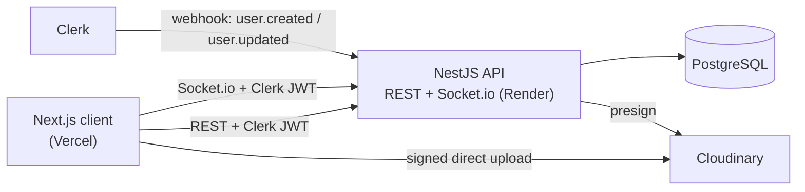

# Infinite Chat

Real-time chat app with direct and group chats, roles, replies, attachments, typing indicators and online status.

**Live demo:** https://infinite-chat-kappa.vercel.app  
**API docs (Swagger):** https://infinite-chat-gf7b.onrender.com/api/docs

> The API is hosted on Render. The first request after an idle period can be slow while the server wakes up.

## Screenshots

<p align="center">
  
  
  
</p>

## Features

- Sign in / sign up with Clerk
- Direct chats and group chats
- Group roles: `OWNER`, `ADMIN`, `MEMBER` (rename group, change avatar, add or kick members, leave)
- Send, edit, delete and restore messages (soft delete)
- Replies to messages
- Attachments: images, video, audio and files (direct upload to Cloudinary)
- Read status and unread counters
- Typing indicator, online status and last seen
- Notifications
- System messages (for example, a member joined the group)
- Optimistic UI with TanStack Query
- Emoji picker and automatic link detection

## Tech stack

| Layer | Tools |
|---|---|
| Client | Next.js 16 (App Router), React 19, TypeScript, Tailwind CSS 4, TanStack Query, socket.io-client |
| API | NestJS 11, Socket.io, class-validator, Swagger (OpenAPI) |
| Database | PostgreSQL 16, Prisma 7 |
| Auth | Clerk (JWT for REST and WebSocket, webhooks to sync users) |
| Files | Cloudinary (signed direct uploads) |
| Deploy | Vercel (client), Render (API) |

## Architecture



Key decisions:

- **Direct uploads.** Files never go through the API. The API only signs an upload slot, the browser uploads to Cloudinary, then sends the file metadata together with the message.
- **Typed API client.** Client types are generated from the Swagger schema and used with `openapi-fetch`.
- **Typed socket events.** Socket events have typed contracts on both the API and the client side.
- **Domain events.** Actions like "member joined" go through an event emitter, and listeners react to them (for example, create a system message).
- **One auth for REST and WebSocket.** The same Clerk JWT protects HTTP routes and the WebSocket handshake.

WebSocket namespaces: `messages`, `rooms`, `presence`, `notifications`.

## Repository structure

```
apps/
├── api/    NestJS backend (REST + Socket.io, Prisma)
└── web/    Next.js frontend
```

Setup, environment variables and details are in each app's README:

- [apps/api](apps/api/README.md)
- [apps/web](apps/web/README.md)

## Quick start

Requirements: Node.js 20+, Docker, a [Clerk](https://clerk.com) app, a [Cloudinary](https://cloudinary.com) account.

```bash
git clone https://github.com/KirillPitomets/infinite-chat.git
cd infinite-chat
```

1. Start the API (database, env, migrations, webhook): see [apps/api/README.md](apps/api/README.md).
2. Start the web app: see [apps/web/README.md](apps/web/README.md).

The client runs on http://localhost:3000, the API on http://localhost:3001.
